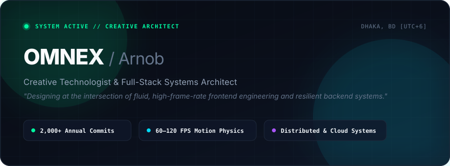

<div align="center">

<!-- Bespoke Obsidian Vector Hero Banner -->


<br /><br />

[](mailto:revenched.arnob@gmail.com)
[](https://github.com/omnex-dev)
[](https://maps.google.com)

</div>

<br />

---

### ✦ The Dual Craft: Interface & Systems

<table>
  <tr>
    <th width="50%" align="left">
       &nbsp; Creative Frontend &amp; Interface Engineering
    </th>
    <th width="50%" align="left">
       &nbsp; Systems, Backend &amp; Data Architecture
    </th>
  </tr>
  <tr>
    <td valign="top">
      <ul>
        <li><strong>Kinetic Motion &amp; Physics:</strong> Hardware-accelerated 60–120 FPS compositor animations via GSAP, Framer Motion, and Web Audio micro-haptics.</li>
        <li><strong>Modern Web Platforms:</strong> Next.js App Router, React 19, TypeScript, responsive multi-viewport layout resilience, and Tailwind CSS.</li>
        <li><strong>Creative Direction:</strong> Typographic hierarchy, dark-mode P3 wide-gamut palettes, zero mobile horizontal overflow, and tactile micro-interactions.</li>
      </ul>
    </td>
    <td valign="top">
      <ul>
        <li><strong>High-Throughput Services:</strong> Asynchronous streaming pipelines, event-driven architectures, and low-latency Node.js/TypeScript APIs.</li>
        <li><strong>Data Integrity &amp; Caching:</strong> PostgreSQL schema modeling, Row-Level Security (RLS), Supabase, and multi-tier Redis caching layers.</li>
        <li><strong>Runtime &amp; DevOps:</strong> Linux environments, Dockerized workflows, WebSockets, background job orchestration, and automated CI/CD pipelines.</li>
      </ul>
    </td>
  </tr>
</table>

<br />

---

### ✦ Engineering Principles

```
01 // ZERO-LATENCY ERGONOMICS
     Digital tools should feel like physical extensions of thought. 
     Optimized bundle footprints, prioritized frame budgets, and optimistic UI updates.

02 // ARCHITECTURAL RESILIENCE
     Software must fail gracefully. Backends are built defensively with 
     strict idempotency, connection pooling, and resilient retry mechanisms.

03 // RESTRAINED EDITORIAL AESTHETIC
     Modern interfaces should command respect through negative space, razor-sharp 
     typographic scale, and purposeful micro-motion—never noisy decorative clutter.
```

<br />

---

### ✦ Weapons of Choice

<div align="center">
  <br />
  <a href="https://skillicons.dev">
    
  </a>
  <br /><br />
</div>

<br />

---

### ✦ Contribution Dynamics

<div align="center">
  
</div>

<br />

<div align="center">
  <sub>Crafted with quiet restraint and performance discipline.</sub>
</div>
