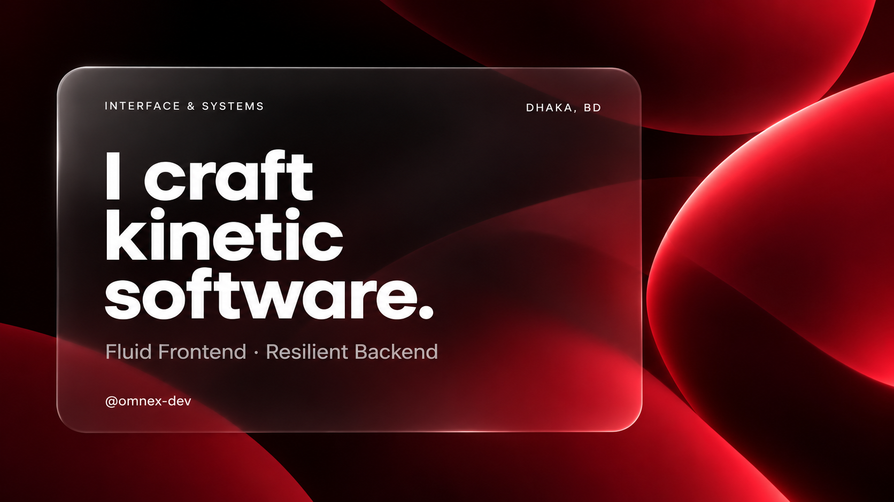

<!-- Crimson Glassmorphic Hero Banner -->

  

  <a href="mailto:revenched.arnob@gmail.com"><code>revenched.arnob@gmail.com</code></a>
  &nbsp;&nbsp;·&nbsp;&nbsp;
  <a href="https://github.com/omnex-dev"><code>@omnex-dev</code></a>
  &nbsp;&nbsp;·&nbsp;&nbsp;
  <code>Dhaka, Bangladesh</code>

 

---

### ✦ Interface Craft

* **Kinetic Motion &amp; Physics:** Hardware-accelerated 60–120 FPS compositor animations via GSAP, Framer Motion, and Web Audio micro-haptics.
* **Modern Web Engineering:** Next.js App Router, React 19, TypeScript, responsive layout resilience, and modern Tailwind CSS.
* **Creative Direction:** Strict typographic scale, dark-mode P3 wide-gamut palettes, zero mobile overflow, and fluid ergonomics.

 

---

### ✦ Systems Architecture

* **High-Throughput Services:** Asynchronous streaming pipelines, event-driven architectures, and low-latency Node.js/TypeScript APIs.
* **Data Integrity &amp; Caching:** PostgreSQL schema modeling, Row-Level Security (RLS), Supabase, and multi-tier Redis caching layers.
* **Runtime &amp; DevOps:** Linux environments, containerized Docker workflows, WebSockets, background job orchestration, and automated CI/CD.

 

---

### ✦ Core Stack

   
  <code>TypeScript</code> &nbsp;·&nbsp;
  <code>React</code> &nbsp;·&nbsp;
  <code>Next.js</code> &nbsp;·&nbsp;
  <code>Tailwind CSS</code> &nbsp;·&nbsp;
  <code>Node.js</code> &nbsp;·&nbsp;
  <code>PostgreSQL</code> &nbsp;·&nbsp;
  <code>Redis</code> &nbsp;·&nbsp;
  <code>Docker</code> &nbsp;·&nbsp;
  <code>Linux</code> &nbsp;·&nbsp;
  <code>Python</code> &nbsp;·&nbsp;
  <code>Git</code>
    

 

---

### ✦ Contribution Dynamics

  

 

  Crafted with quiet restraint and performance discipline.

